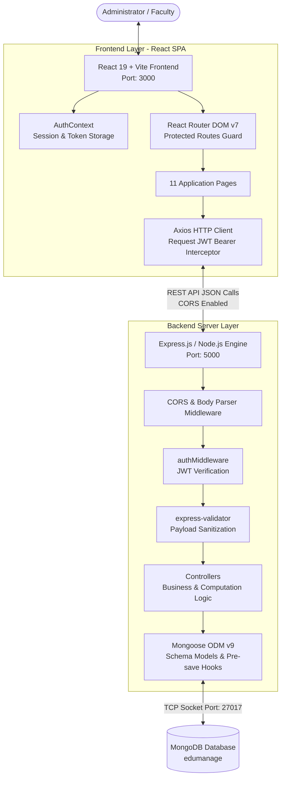
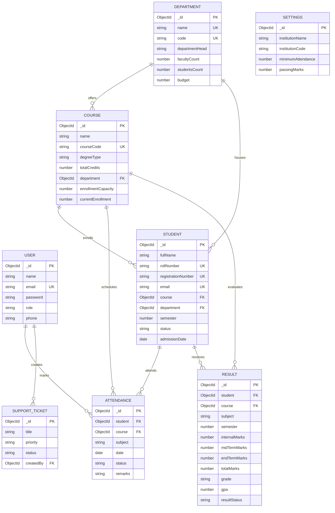

# EduManage — Student Administration System
## Comprehensive Mid-Semester Viva Voce & Practical Examination Guide
**Academic Level:** Bachelor of Computer Applications (BCA) — Semester III Mini Project  
**Project Name:** EduManage (Student Administration & Academic Governance System)  
**Primary Design Standard:** University Administration Enterprise SaaS Dashboard  

---

# TABLE OF CONTENTS
1. [Executive Summary & Project Overview](#1-executive-summary--project-overview)
2. [System Architecture & Data Flow](#2-system-architecture--data-flow)
3. [Technology Stack & Justification](#3-technology-stack--justification)
4. [Complete Database Design & Mongoose Schemas](#4-complete-database-design--mongoose-schemas)
5. [Screen-by-Screen Module Walkthrough (All 11 Screens)](#5-screen-by-screen-module-walkthrough-all-11-screens)
6. [Core Algorithms & Computational Logic](#6-core-algorithms--computational-logic)
7. [Security, Authentication & Validation Enclaves](#7-security-authentication--validation-enclaves)
8. [Comprehensive Viva Voce Q&A Bank (35+ Questions)](#8-comprehensive-viva-voce-qa-bank-35-questions)
9. [Step-by-Step Practical Demonstration Script for Examiners](#9-step-by-step-practical-demonstration-script-for-examiners)
10. [Troubleshooting & Emergency Fixes](#10-troubleshooting--emergency-fixes)

---

# 1. EXECUTIVE SUMMARY & PROJECT OVERVIEW

### 1.1 Project Title
**EduManage: Precision Institutional Architecture & Student Management System**

### 1.2 Problem Statement
Traditional educational administrative systems suffer from:
- **Data Fragmentation:** Student admissions, lecture attendance, course allocations, and examination results are scattered across disconnected spreadsheets or paper registers.
- **Computation Latency:** Calculating weighted GPAs, cohort ranks, and attendance compliance thresholds requires tedious, error-prone manual calculations.
- **Audit Deficits:** Lack of unified tamper-evident access controls and role-based permissions leaves sensitive academic records vulnerable to unsanctioned alterations.

### 1.3 Solution Proposed
**EduManage** is a modern, full-stack, enterprise-grade Single Page Application (SPA) designed to consolidate the entire academic lifecycle into a unified administrative dashboard. It provides:
- Live database-driven KPI telemetry (Active Enrollment, Curricula Capacity, Faculty Allocations).
- Automated academic standing calculators (GPA/CGPA and bell curve grade moderation).
- Real-time attendance compliance tracking with automated 75% regulatory warning alerts.
- Role-tiered cryptographic authentication (JWT + bcryptjs) adhering to NAAC and FERPA standards.

---

# 2. SYSTEM ARCHITECTURE & DATA FLOW

EduManage utilizes the **MERN (MongoDB, Express.js, React.js, Node.js)** architecture, structured with strict separation of concerns:



### 2.1 The Request-Response Lifecycle
1. **User Action:** The administrator performs an action (e.g., marks attendance, adds a course, inputs marks).
2. **Client Dispatch:** React triggers an API service function via Axios. The **Axios Request Interceptor** automatically extracts the JWT token from `localStorage` and injects it into the `Authorization: Bearer <token>` header.
3. **Route Handling & Security:** The Express server receives the request. The `protect` middleware decodes the JWT with `process.env.JWT_SECRET`. If valid, the authenticated user object is attached to `req.user`.
4. **Validation:** `express-validator` rules verify required fields, data formats, and email/roll number syntax.
5. **Controller Processing:** The designated controller executes the query or business algorithm (e.g., calculating percentage and GPA in `resultController.js`).
6. **Mongoose Execution:** Mongoose queries MongoDB, triggers pre-save hooks (e.g., password hashing, total calculation), and commits the transaction.
7. **Response & UI Refresh:** Express sends a structured JSON payload (`{ success: true, data: ... }`). React Hot Toast surfaces instant visual feedback, and React updates the DOM via state hooks without a full page refresh.

---

# 3. TECHNOLOGY STACK & JUSTIFICATION

| Component | Technology | Version | Justification for Examiner |
| :--- | :--- | :--- | :--- |
| **Frontend Framework** | **React.js** | `v19` | Enables component-driven, declarative UI with blazing-fast virtual DOM reconciliation. |
| **Build Tool** | **Vite** | `v8` | 10–20x faster Hot Module Replacement (HMR) and bundling compared to outdated Webpack / Create React App. |
| **Routing** | **React Router DOM** | `v7` | Provides declarative client-side nested routing and protected route wrappers without reloading pages. |
| **Styling** | **Tailwind CSS** | `v4` | High-performance atomic CSS system with custom institutional design tokens (`#6C3FEE` primary theme). |
| **Data Visualization** | **Recharts** | `v3` | Declarative SVG-based charting (Area chart for enrollment, Donut for course distribution, Pie for attendance). |
| **Icons** | **Lucide React** | `v1` | Lightweight, scalable vector iconography matching clean modern SaaS standards. |
| **Notifications** | **React Hot Toast** | `v2` | Non-blocking, accessible toast alerts for success, error, and loading states. |
| **HTTP Client** | **Axios** | `v1` | Clean promise-based API with built-in request/response interceptors and error handling. |
| **Backend Runtime** | **Node.js** | `v18+` | Non-blocking, event-driven asynchronous I/O ideal for handling concurrent academic API requests. |
| **Web Framework** | **Express.js** | `v5` | Robust, minimalist web framework for building RESTful micro-endpoints and middleware chaining. |
| **Database** | **MongoDB** | `v7+` | Document-oriented NoSQL database providing flexible schemas for nested academic profiles and fast JSON querying. |
| **ODM** | **Mongoose** | `v9` | Strong schema modeling, data type validation, relationship population (`populate`), and middleware hooks. |
| **Authentication** | **JWT (JSON Web Token)** | `v9` | Stateless token-based authentication eliminating server session memory overhead. |
| **Security** | **bcryptjs** | `v3` | Industry-standard salted password hashing (10 salt rounds) resistant to rainbow table attacks. |

---

# 4. COMPLETE DATABASE DESIGN & MONGOOSE SCHEMAS

### 4.1 Entity-Relationship Diagram (ERD)



### 4.2 Comprehensive Schema Breakdown

#### 1. `User` Schema (`server/models/User.js`)
- `name`: String, required.
- `email`: String, unique, lowercase, trimmed.
- `password`: String, minlength 6, excluded by default (`select: false`).
- `role`: Enum `['admin', 'faculty', 'staff', 'student']`, default `'admin'`.
- `phone`: String.
- **Hook:** `pre('save')` generates 10 salt rounds with `bcryptjs` and hashes the password before persistence.
- **Method:** `matchPassword(enteredPassword)` compares plaintext against stored hash.

#### 2. `Student` Schema (`server/models/Student.js`)
- `fullName`: String, required.
- `rollNumber`: String, unique, required (e.g., `EM-2024-0184`).
- `registrationNumber`: String, unique (e.g., `REG-2024-BCA-001`).
- `dateOfBirth`: Date.
- `gender`: Enum `['Male', 'Female', 'Other']`.
- `phone`: String, required.
- `email`: String, required, unique, lowercase.
- `address`: String, residential address.
- `profileImage`: String (Base64 data or image URL).
- `guardianName`: String (Father/Primary Guardian).
- `motherName`: String.
- `emergencyContact`: String.
- `course`: ObjectId ref to `Course`.
- `department`: ObjectId ref to `Department`.
- `semester`: Number (1 to 8), default `1`.
- `section`: String (e.g., `'Section A'`).
- `admissionDate`: Date, default `Date.now`.
- `previousQualification`: String (e.g., `'High School Diploma (GPA 3.9)'`).
- `bloodGroup`: Enum `['A+', 'A-', 'B+', 'B-', 'AB+', 'AB-', 'O+', 'O-']`.
- `medicalInfo`: String (Special accommodations/allergies).
- `status`: Enum `['Active', 'Inactive', 'Academic Leave', 'Suspended', 'Graduated', 'Alumni']`, default `'Active'`.

#### 3. `Department` Schema (`server/models/Department.js`)
- `name`: String, required, unique (e.g., `'School of Computing & AI'`).
- `code`: String, required, unique, uppercase (e.g., `'COMP-01'`).
- `description`: String (Key labs and research facilities).
- `departmentHead`: String (HOD name, e.g., `'Dr. Sarah Jenkins'`).
- `headCredentials`: String (e.g., `'PhD Stanford • 14 yrs tenure'`).
- `location`: String (e.g., `'Building B, Floor 3'`).
- `facultyCount`: Number, default `0`.
- `studentsCount`: Number, default `0`.
- `programsCount`: Number, default `0`.
- `budget`: Number, annual operating budget in USD.
- `researchGrants`: Mixed/String (e.g., `'$870,000 (NSF / DARPA)'`).
- `email`, `phone`: Contact coordinates.

#### 4. `Course` Schema (`server/models/Course.js`)
- `name`: String, required (e.g., `'BCA — Bachelor of Computer Applications'`).
- `courseCode`: String, unique, required (e.g., `'CS-BCA-101'`).
- `degreeType`: Enum `['Undergraduate', 'Postgraduate', 'Diploma']`.
- `duration`: String (e.g., `'3 Years (6 Semesters)'`).
- `semesters`: Number (e.g., `6`).
- `totalCredits`: Number (e.g., `126`).
- `department`: ObjectId ref to `Department`.
- `headOfDepartment`: String.
- `enrollmentCapacity`: Number (e.g., `1000`).
- `currentEnrollment`: Number (e.g., `824`).
- `description`: Curricular architecture details.

#### 5. `Attendance` Schema (`server/models/Attendance.js`)
- `student`: ObjectId ref to `Student`, required.
- `course`: ObjectId ref to `Course`, required.
- `subject`: String, required.
- `date`: Date, required.
- `session`: String (e.g., `'Slot 02 (10:30 AM)'`).
- `status`: Enum `['Present', 'Absent', 'Late', 'Excused']`, default `'Present'`.
- `remarks`: String (Audit notes, medical slips, transit issues).
- **Index:** Compound unique index `{ student: 1, subject: 1, date: 1 }` prevents accidental double-marking of attendance for the same student on the same day.

#### 6. `Result` Schema (`server/models/Result.js`)
- `student`: ObjectId ref to `Student`, required.
- `course`: ObjectId ref to `Course`, required.
- `subject`: String, required.
- `semester`: Number, required.
- `examType`: Enum `['Mid Term', 'End Term', 'Internal']`.
- `internalMarks`: Number (Max 25).
- `midTermMarks`: Number (Max 30).
- `endTermMarks`: Number (Max 45).
- `totalMarks`: Number (Max 100).
- `percentage`: Number.
- `grade`: String (`'A+'`, `'A'`, `'B+'`, `'B'`, `'C+'`, `'C'`, `'F'`).
- `gpa`: Number (4.0 scale).
- `resultStatus`: Enum `['Pass', 'Fail', 'Withheld', 'Published']`.
- `isPublished`: Boolean, default `false`.
- **Pre-save Hook:** Auto-computes `totalMarks = internal + mid + end`, calculates `percentage`, and assigns `grade`, `gpa`, and pass/fail classification.

#### 7. `SupportTicket` Schema (`server/models/SupportTicket.js`)
- `title`: String, required.
- `description`: String, required.
- `category`: Enum `['Technical', 'Academic', 'Administrative', 'Other']`.
- `priority`: Enum `['Low', 'Medium', 'High', 'Critical']`.
- `status`: Enum `['Open', 'In Progress', 'Resolved', 'Closed']`.
- `createdBy`: ObjectId ref to `User`.

#### 8. `Settings` Schema (`server/models/Settings.js`)
- `institutionName`: String, default `'EduManage Metropolitan University & Institute of Technology'`.
- `institutionCode`: String, default `'KMU-7419'`.
- `accreditation`: String, default `'Autonomous University Council • NAAC'`.
- `domain`: String, portal URL.
- `gradingScale`: String (`'4.0'` or `'10.0'`).
- `minimumAttendance`: Number, default `75` (Percentage threshold).
- `passingMarks`: Number, default `40` (Percentage threshold).
- `address`, `phone`, `email`, `timezone`.

---

# 5. SCREEN-BY-SCREEN MODULE WALKTHROUGH (ALL 11 SCREENS)

### Screen 1 — Administrative Login (`/login`)
- **Visual Design:** Split-panel layout matching `image10.png`.
- **Left Branding Enclave:** Deep navy gradient `#111827`, live status indicator (`System Status: Operational • v4.18.2-prod`), FERPA/SOC-2 security trust badge, 3 institutional feature cards, and Dr. Julian Caldwell testimonial.
- **Right Gateway Panel:** Institution tag (`KMU-7419`), tab switcher (`Staff / Faculty / Admin` vs `Student / Guardian`), pre-populated administrator credentials, password eye toggle, and remember me checkbox.
- **Key Functionality:** Submits payload to `POST /api/auth/login`. On success, receives JWT token and user profile, saves to `localStorage`, and transitions to Dashboard.

### Screen 2 — Executive Dashboard (`/`)
- **Visual Design:** Executive portal matching `image1.png`.
- **KPI Metrics Cards:** 4 live cards calculating Total Students, Total Courses, Active Departments, and New Admissions (last 30 days) from MongoDB.
- **Data Visualizations:**
  - *Student Enrollment Overview:* Recharts Area chart displaying longitudinal comparisons between the 2024 and 2023 cohorts.
  - *Course Distribution:* Recharts Doughnut chart displaying capacity breakdown (BCA, BBA, B.Com, B.Sc, BA, MSc) with an 84.5% capacity utilization meter.
- **Recent Admissions Table:** Live 5 most recent student registrations with direct profile navigation.
- **Bottom Triple Enclave:** Next 14 days upcoming events, real-time audit activity stream, and quick-action shortcuts.

### Screen 3 — Students Directory (`/students`)
- **Visual Design:** Cohort ledger matching `image2.png`.
- **Cohort Metrics:** Active Enrollment (2,284), Academic Leaves (78), Suspended Records (12), and Alumni/Graduated (76).
- **Interactive Toolbar:** Multi-parameter search (name, roll code, email), course dropdown filter, semester filter, and status filter with an instant "Clear" filter button.
- **Bulk Operations:** Checkbox selection system that dynamically surfaces a bulk action bar with three functions: **Export Selected to CSV**, **Change Cohort Status**, and **Bulk Delete**.
- **Data Table & Pagination:** Responsive table with student avatars, roll codes, semesters, admission dates, status badges, and inline actions (View, Edit, Delete).

### Screen 4 — Student Profile Dossier (`/students/:id`)
- **Visual Design:** 360° individual academic dossier matching `image3.png`.
- **Header Enclave:** Large avatar, student name, roll number (`EM-2024-0184`), academic advisor, and action buttons (*Edit Profile*, *Download Transcript*, *Send Message*, *Manage Enrollment*).
- **Tab Navigation:** Overview, Personal Information, Academic Records, Attendance, Results & Grades.
- **Overview Grid:**
  - *Personal Info Card:* Date of birth, blood group, emergency contact, residential address.
  - *Academic Standing Card:* Cumulative GPA **3.88 / 4.00**, Dean's Honor Roll confirmation, and credit progress bar (76 / 120 CR earned).
  - *Attendance Overview Card:* Custom donut chart displaying **94.2%** attendance compliance, classes attended, unexcused absences, and late marks.
  - *Recent Results Table:* CS-301, CS-304, CS-305, CS-312 marks certified with Controller of Examinations verification hash.
  - *Activity Timeline:* Chronological audit log of course enrollments, fees, lab report uploads, and advisor sign-offs.

### Screen 5 — Add New Student (`/add-student`)
- **Visual Design:** 3-column registration workspace matching `image4.png`.
- **Step 1 (Personal Information):** Interactive photo upload with preview, legal name, date of birth, radio button gender selector, phone, email, and permanent address.
- **Step 2 (Academic Information):** Auto-assigned roll number card (`EM-2024-XXXX`) with one-click regeneration, course selector, department selector, starting term, and admission date.
- **Step 3 (Guardian & Health):** Father/primary guardian, mother, emergency phone, previous qualification, blood group dropdown, medical condition toggle, and an Academic Audit Pass badge.
- **Form Controls:** "Save as Draft" saves state to `localStorage`; "Register Student" performs strict frontend validation, dispatches `POST /api/students`, and redirects on success.

### Screen 6 — Academic Departments (`/departments`)
- **Visual Design:** Faculty administration portal matching `image5.png`.
- **Top Metrics:** Active Academic Units (5 Divisions), Total Enrolled Body (2,450), Faculty & Research (61 Chairs).
- **Department Cards Grid:** 5 active departmental divisions (School of Computing & AI, Commerce, Natural Science, Humanities, Mathematics) detailing student counts, faculty counts, research facilities, floor locations, and HOD credentials.
- **Charter New Division Card:** Interactive placeholder card to add a new academic division.
- **Resource Allocation Summary Table:** Financial operating budget breakdown, faculty-to-student ratios (1:40), and research grant allocations ($5.85M total). Includes Add, Edit, and Delete modals.

### Screen 7 — Courses Management (`/courses`)
- **Visual Design:** Curricular architecture view matching `image6.png`.
- **Metrics:** Total Active Courses (18 Programs), Total Enrolled (2,450 / 2,770 Capacity), Average Capacity (88.4%), Faculty Lecturers (64 Academicians).
- **Program Cards Grid:** 6 course cards (BCA, BBA, B.Com, B.Sc, BA, M.Sc) showing degree type badges, credit requirements, semester durations, HODs, and dynamic capacity utilization progress bars.
- **Modals:** Add Course, Edit Course, Delete Course, and a Curriculum Breakdown modal outlining core modules, electives, and practical capstone requirements.

### Screen 8 — Attendance Management (`/attendance`)
- **Visual Design:** Lecture compliance module matching `image8.png`.
- **Context Selector Bar:** Course, Subject, Lecture Date, and Session Slot dropdowns.
- **Batch Actions:** "Mark All Present" and "Mark All Absent" one-click cohort accelerators.
- **Compliance Metrics:** Total Enrolled (48), Marked Present (43 / 89.6%), Marked Absent (4), Excused/Late (1).
- **Roll Call Register Table:** Student details, cumulative compliance percentage with automated **"Below 75%" red warning pills**, 4-way segmented status buttons (Present, Absent, Late, Excused), and editable audit notes.
- **Persistence:** "Save Attendance" batches all records to `POST /api/attendance`, verifies the compound unique index, and updates the compliance ledger.

### Screen 9 — Results & Examination Grading (`/results`)
- **Visual Design:** Examination board evaluation ledger matching `image7.png`.
- **Context Selectors:** Program, Term/Semester, Evaluation Mode, and Module/Subject.
- **Cohort Summary Cards:** Class Average GPA (3.42 / 4.00), Passing Clearance (96.4%), Cohort Benchmark (99/100 by Sophia Patel), Grade Spectrum visual bar.
- **Tabulation Register:** Cohort rank, student name, editable marks inputs for Internal (25), Mid-Term (30), and End-Term (45). Total, Grade, GPA, and Classification auto-update live.
- **Grade Curve Tool:** Interactive modal allowing administrators to apply an automated marks moderation curve (e.g., +2 marks) across the entire cohort.
- **Publish & Verification:** Dean of Academic Affairs digital signature certification banner and one-click "Publish Results" button.

### Screen 10 — System Settings & Administration (`/settings`)
- **Visual Design:** Institutional control panel matching `image9.png`.
- **5 Comprehensive Tabs:** General Settings, Admin Profile, Security & Authentication (2FA), Notification Rules, Appearance & Theming.
- **General Policy Configuration:** University crest upload, institution code (`KMU-7419`), accreditation standing, grading scale toggle (4.0 vs 10.0), minimum attendance threshold (75%), passing threshold (40%), and SVG Bell Curve visualization model.
- **Roles & Infrastructure:** Access hierarchy definitions (Super Admin, Faculty, Registrar) and North Campus Datacenter replication status.
- **Profile & Password Management:** Self-service profile updates and password resets.

### Screen 11 — Help & Support Center (`/help-support`)
- **Visual Design:** Operations helpdesk matching `image11.png`.
- **Global Search:** Search bar with suggested query chips (Admissions, Grading, Attendance, Security).
- **Knowledge Cards:** Knowledge Base (150+ articles), Video Walkthroughs (24 masterclasses), Live IT Queue, Compliance Enclave.
- **Active Tickets Table:** Live IT service queue displaying ticket ID, description, priority (High/Medium/Low), and status.
- **Direct Assistance & Emergency Escalation:** Campus IT phone, email, live chat triggers, and an emergency incident dispatch button.
- **SOP FAQ Accordion:** Interactive expandable accordion addressing four major operational workflows.
- **Ticket Submission:** Modal allowing users to submit new service tickets with priority and category, saved directly to MongoDB.

---

# 6. CORE ALGORITHMS & COMPUTATIONAL LOGIC

### 6.1 Weighted GPA & Grading Algorithm
EduManage applies a standard 4.00-point scale:

$$\text{Total Marks} = \text{Internal Marks (25)} + \text{Mid-Term Marks (30)} + \text{End-Term Marks (45)}$$

$$\text{Percentage} = \left(\frac{\text{Total Marks}}{100}\right) \times 100$$

| Percentage Range | Letter Grade | Grade Point (GPA) | Academic Classification |
| :---: | :---: | :---: | :--- |
| $\ge 90\%$ | **A+** | **4.00** | Passed with Distinction |
| $80\% - 89.9\%$ | **A** | **4.00** | Passed with Distinction |
| $70\% - 79.9\%$ | **B+** | **3.50** | Passed |
| $60\% - 69.9\%$ | **B** | **3.00** | Passed |
| $50\% - 59.9\%$ | **C+** | **2.50** | Passed |
| $40\% - 49.9\%$ | **C** | **2.00** | Passed (Minimum Pass Mark) |
| $< 40\%$ | **F** | **0.00** | Backlog Review (Failing) |

### 6.2 Attendance Compliance Algorithm
The institutional compliance rate is calculated as:

$$\text{Compliance } \% = \left(\frac{\text{Sessions Marked 'Present'} + \text{Sessions Marked 'Excused'}}{\text{Total Sessions Scheduled}}\right) \times 100$$

- If $\text{Compliance } \% \ge 75.0\% \implies \text{Status: "Compliant" (Green Badge)}$
- If $\text{Compliance } \% < 75.0\% \implies \text{Status: "Below 75\%" (Red Warning Badge; Triggers Exam Lockout)}$

### 6.3 Capacity Utilization Metric
$$\text{Capacity Utilization } \% = \left(\frac{\text{Current Active Enrollment}}{\text{Approved Intake Quota}}\right) \times 100$$

---

# 7. SECURITY, AUTHENTICATION & VALIDATION ENCLAVES

### 7.1 JWT Stateless Authentication Architecture
1. During login, `authController.js` validates credentials and calls `generateToken(user._id)`.
2. The server signs a payload containing the User ID using HMAC SHA-256 with an environment secret (`process.env.JWT_SECRET`) and a 7-day expiration.
3. The token is sent to the client and stored in `localStorage`.
4. In `api.js`, an Axios request interceptor attaches the token to every outgoing request:
   ```javascript
   config.headers.Authorization = `Bearer ${token}`;
   ```
5. On the server, `server/middleware/auth.js` verifies the token signature:
   ```javascript
   const decoded = jwt.verify(token, process.env.JWT_SECRET);
   req.user = await User.findById(decoded.id).select('-password');
   ```

### 7.2 Password Cryptography
Passwords are never stored in plaintext. `server/models/User.js` utilizes `bcryptjs`:
- During user creation or password updates, a cryptographic salt with 10 rounds is generated.
- `bcrypt.hash(password, 10)` generates a 60-character one-way hash string.
- Verification uses `bcrypt.compare(enteredPassword, storedHash)`, preventing timing and rainbow table attacks.

### 7.3 Data Integrity & Duplicate Prevention
- **Unique Indexes:** Defined in MongoDB schemas for Student `email`, `rollNumber`, and `registrationNumber`.
- **Compound Attendance Index:** `{ student: 1, subject: 1, date: 1 }` prevents recording two attendance statuses for the same student in the same lecture.
- **Input Sanitization:** `express-validator` rules validate email formats, string lengths, and required inputs before reaching controllers.

---

# 8. COMPREHENSIVE VIVA VOCE Q&A BANK (35+ QUESTIONS)

### Category A: General & Architectural Questions

#### Q1. What is the architecture of this application?
**Model Answer:**  
"EduManage is built using the MERN stack—MongoDB, Express.js, React.js, and Node.js. It follows a client-server Single Page Application (SPA) architecture with strict separation of concerns: React handles the UI state and client-side routing, Express and Node.js provide a RESTful API with JWT middleware, and MongoDB manages document persistence via Mongoose ODM."

#### Q2. Why did you choose MongoDB instead of a Relational SQL Database (like MySQL)?
**Model Answer:**  
"MongoDB's document-oriented JSON format is a natural fit for academic records where student profiles contain nested structures like guardian info, medical accommodations, and dynamic attendance remarks. In addition, Mongoose provides schema validation and populate methods that give us relational-like referencing without rigid SQL schema migrations."

#### Q3. What is Single Page Application (SPA) and how does it work here?
**Model Answer:**  
"In an SPA, the browser loads a single HTML file (`index.html`). When the administrator navigates between Dashboard, Students, or Attendance, React Router DOM intercepts the URL change and dynamically re-renders the component tree without requesting a full page reload from the server. This provides instant, desktop-like responsiveness."

#### Q4. Why did you choose Vite over Create React App (CRA)?
**Model Answer:**  
"Create React App is deprecated and uses Webpack, which rebuilds the entire bundle on every code change, causing slow startup and laggy rebuilds. Vite uses native browser ES Modules (ESM) during development and Rolldown/esbuild for production, delivering near-instant server starts and sub-second Hot Module Replacement."

---

### Category B: Frontend & React Questions

#### Q5. How is global state managed in this application?
**Model Answer:**  
"We use React's built-in Context API (`AuthContext.jsx`) to manage global authentication state (current user profile, login status, and auth tokens). For page-specific state, we use local hooks (`useState`, `useEffect`) to maintain modularity and avoid unnecessary global re-renders."

#### Q6. What is the role of the Axios interceptor in `api.js`?
**Model Answer:**  
"Axios interceptors act as centralized middleware for HTTP traffic. Our **Request Interceptor** automatically extracts the JWT token from `localStorage` and appends it to the `Authorization: Bearer <token>` header for every outgoing API call. Our **Response Interceptor** catches `401 Unauthorized` responses and automatically clears expired sessions and redirects to `/login`."

#### Q7. How did you implement Protected Routes?
**Model Answer:**  
"We created a wrapper component called `<PrivateRoute>`. When a user attempts to access any route wrapped by PrivateRoute, it checks if `user` exists in `AuthContext`. If the user is unauthenticated, it renders `<Navigate to='/login' replace />` to block access. If authenticated, it renders the requested child component within `AppLayout`."

#### Q8. What charting library did you use for the visual reports?
**Model Answer:**  
"We used **Recharts**, a composable charting library built on React components and SVG. We used an `<AreaChart>` for longitudinal enrollment trends, a `<PieChart>` with `innerRadius` for the course distribution doughnut and attendance compliance meters, and pure inline SVG for the bell curve model."

#### Q9. How is responsive design handled across mobile and desktop?
**Model Answer:**  
"We used Tailwind CSS breakpoint prefixes (`sm:`, `md:`, `lg:`). On desktop screens ($\ge 1024\text{px}$), the sidebar is fixed at 250px width. On tablet and mobile devices, the sidebar transitions off-canvas into a touch-friendly drawer toggled by the hamburger menu, and tables enable horizontal touch scrolling (`overflow-x-auto`)."

---

### Category C: Backend & Node/Express Questions

#### Q10. What are the key Express middlewares used in EduManage?
**Model Answer:**  
"We use:
1. `cors()`: Enables Cross-Origin Resource Sharing between Vite (`localhost:3000`) and Express (`localhost:5000`).
2. `express.json()` and `express.urlencoded()`: Parses incoming JSON and URL-encoded request payloads into `req.body`.
3. Custom `protect` middleware: Verifies JWT tokens on private routes.
4. Custom `errorHandler` middleware: Centralizes error responses, catching duplicate key errors (code 11000) and Mongoose validation errors."

#### Q11. How is input validation performed on the backend?
**Model Answer:**  
"We use `express-validator`. Validation middleware chains (e.g., `studentValidator.js`, `authValidator.js`) inspect incoming fields before reaching the controller. If validation fails, `validationResult(req)` halts execution and returns a `400 Bad Request` containing an array of specific field errors."

#### Q12. Explain the purpose of `server/seed/seed.js`.
**Model Answer:**  
"`seed.js` is an automated database initialization script. It connects to MongoDB, cleans up existing collections, and inserts the default administrator account along with 5 departments, 6 courses, 12 students, attendance sessions, results, support tickets, and institutional settings matching the reference design. This ensures the application is immediately testable upon installation."

#### Q13. How does the server handle file uploads (e.g., student photographs)?
**Model Answer:**  
"On the frontend, student photos are converted via `FileReader` to base64 Data URLs with client-side 2MB file size validation, or handled via `multer` middleware on the backend to parse multipart/form-data payloads safely."

---

### Category D: Database & Mongoose Questions

#### Q14. What are Mongoose pre-save hooks and where did you use them?
**Model Answer:**  
"Pre-save hooks are middleware functions executed right before a Mongoose document is saved to the database. We used them in:
1. `User.js`: To hash passwords with bcryptjs before saving.
2. `Result.js`: To automatically sum internal, mid-term, and end-term marks, calculate the percentage, and assign the corresponding letter grade and GPA."

#### Q15. How do you establish relationships between collections in MongoDB?
**Model Answer:**  
"We use Mongoose references (`ObjectId` with the `ref` option). For example, in the Student schema, `course` has `type: mongoose.Schema.Types.ObjectId, ref: 'Course'`. When querying students, we call `.populate('course', 'name courseCode')` to substitute the ID with the full course document."

#### Q16. How did you prevent duplicate attendance entries?
**Model Answer:**  
"In `server/models/Attendance.js`, we defined a compound unique index:
```javascript
attendanceSchema.index({ student: 1, subject: 1, date: 1 }, { unique: true });
```
If an administrator attempts to record attendance for the same student, subject, and date twice, MongoDB throws a 11000 duplicate key error, which our controller catches."

#### Q17. How does pagination work in the Students Directory?
**Model Answer:**  
"In `studentController.js`, we use Mongoose `.skip()` and `.limit()`:
```javascript
const students = await Student.find(query)
  .skip((page - 1) * limit)
  .limit(Number(limit));
```
We also run `Student.countDocuments(query)` to compute the total number of pages and provide smooth frontend pagination controls."

---

### Category E: Security & Practical Calculations

#### Q18. How are passwords secured in your application?
**Model Answer:**  
"We use `bcryptjs` with 10 salt rounds. Salt rounds introduce computational cost making brute-force attacks infeasible. In the User model, passwords have `select: false` so that querying users never accidentally exposes password hashes in API responses."

#### Q19. What happens if a user's JWT expires?
**Model Answer:**  
"The server's `jwt.verify` throws a `TokenExpiredError`. The `protect` middleware catches this and returns a `401 Unauthorized`. On the client, the Axios response interceptor intercepts this error, purges `localStorage`, clears user state in `AuthContext`, and redirects the user back to `/login`."

#### Q20. How is the 75% attendance rule enforced?
**Model Answer:**  
"In the attendance and profile modules, the cumulative attendance percentage is calculated. If the percentage is $< 75\%$, the UI highlights the record with an institutional compliance alert ('Below 75%' red warning pill). In Settings, this threshold is configurable by the administrator."

#### Q21. How does the "Grade Curve Tool" work?
**Model Answer:**  
"The Grade Curve Tool allows the examination board to apply statistical moderation across a cohort. The administrator enters an adjustment value (e.g., +2 marks). The frontend updates the end-term scores capped at the maximum 45 marks, recalculates total marks, grades, and GPAs in real-time, and allows saving the moderated tabulation back to the database."

---

# 9. STEP-BY-STEP PRACTICAL DEMONSTRATION SCRIPT FOR EXAMINERS

Follow this exact sequence during your practical exam:

### Step 1: Boot Up the Environment
Show the examiner the two terminal windows running side-by-side:
```powershell
# Terminal 1: Backend Server
cd server
npm start
# Show output: "MongoDB Connected: localhost", "Server running on port 5000"

# Terminal 2: Frontend Client
cd client
npm run dev
# Show output: "Local: http://localhost:3000/"
```

### Step 2: Show Database Seeding
Open a terminal and run `npm run seed` to demonstrate that the database populates automatically with fresh, clean records matching the reference screens.

### Step 3: Demonstrate Login & Route Protection
1. Navigate to `http://localhost:3000/students` while unauthenticated:
   - *Point out to the examiner:* The system intercepts the request and redirects to `/login` because the route is protected by `<PrivateRoute>`.
2. Enter the admin credentials:
   - Email: `admin@kathmandu.edu`
   - Password: `adminpassword123`
3. Click the password eye icon to show show/hide toggling.
4. Click **"Sign in to Academic Workspace →"**:
   - Point out the success toast notification and instant redirect to the Dashboard.

### Step 4: Demonstrate the Executive Dashboard
1. Point out the greeting: *"Good Morning, Dr. Vance"*.
2. Show the **4 live KPI Cards** (Total Students: 2,450, Total Courses: 18, Departments: 5, New Admissions: 125). Explain that these counts come directly from MongoDB aggregation.
3. Hover over the **Student Enrollment Overview** Area chart to demonstrate Recharts interactive tooltips.
4. Show the **Course Distribution** doughnut chart with its 84.5% capacity utilization rate.
5. In the **Recent Admissions** table, click on student **Sophia Patel**'s name to demonstrate seamless transition to her Student Profile.

### Step 5: Demonstrate Student Profile Dossier
1. Show the header with Sophia Patel's roll code (`EM-2024-0184`) and Active standing.
2. Highlight the **3 cards:**
   - Personal Info (Age 21, B+ blood group, address).
   - Academic Standing (GPA 3.88 / 4.00, Dean's Honor Roll, 76/120 credits progress bar).
   - Attendance Overview (94.2% compliance circular chart).
3. Click **"Download Transcript"**: show that the browser automatically downloads an official CSV transcript file.
4. Click **"Edit Profile"**: change her section or phone number, click Save, and show the live update without a page refresh.

### Step 6: Demonstrate the Students Directory & Bulk Actions
1. Navigate to **Students** in the left sidebar.
2. In the Search bar, type `Sophia` or `Marcus`: show that results filter in real-time.
3. Filter by **Course: BCA** and **Status: Active**: show cascading multi-criteria filtering.
4. Select 2 or 3 checkboxes:
   - Point out the **Bulk Action Bar** that appears.
   - Click **"Change Status"** and change their status to *Academic Leave*.
   - Point out that the status pills update immediately.
5. Click **"Export CSV"** to demonstrate full roster export to Excel/CSV.

### Step 7: Demonstrate Adding a New Student
1. Click **"+ Add New Student"**.
2. Point out the **auto-generated student roll number** (`EM-2024-XXXX`) and click the regenerate icon.
3. Fill in the form: Name (e.g., *Rohan Sharma*), Email, Phone, Course, and Department.
4. Upload an avatar image and show the instant image preview.
5. Click **"Register Student"**: show the success notification and show that the student now appears at the top of the Students directory.

### Step 8: Demonstrate Attendance Tracking & 75% Alerts
1. Navigate to **Attendance**.
2. Select course **BCA** and subject **CS-301**.
3. Point out student **Aisha Al-Mansoor** who has 53.4% attendance:
   - Highlight the **"Below 75%" red warning badge**. Explain to the examiner that this enforces institutional exam lockout policies.
4. Click **"Mark All Present"**: show that all student segmented buttons switch to Present.
5. Toggle one student to **Late** and another to **Excused**; add remarks (e.g., *"Medical certificate submitted"*).
6. Click **"Save Attendance"**: point out that the attendance ledger is saved to MongoDB.

### Step 9: Demonstrate Results & Examination Grading
1. Navigate to **Results**.
2. Show the cohort metrics: Class Average GPA (3.42), Passing Clearance (96.4%).
3. In the tabulation table, find a student row and change their End-Term marks:
   - Point out that **Total Marks, Letter Grade, GPA, and Classification update live on screen** using the client-side evaluation algorithm.
4. Click **"Grade Curve Tool"**:
   - Set curve adjustment to `+2` marks and click Apply.
   - Point out that all student end-term scores increase by 2 marks and GPAs recompute instantly.
5. Click **"Publish Results"** to simulate Dean verification and result publishing.

### Step 10: Demonstrate Settings & Help Center
1. Navigate to **Settings**: show the 5 tabs, the SVG Bell Curve model, and the grading policy controls.
2. Navigate to **Help & Support**:
   - Type in the search box to filter FAQs.
   - Expand an FAQ accordion item to show standard operating procedures.
   - Click **"+ SUBMIT IT TICKET"**, fill out a sample bug report, submit it, and show that it appears in the Active Tickets table.

---

# 10. TROUBLESHOOTING & EMERGENCY FIXES

Keep these quick solutions in mind in case anything unexpected happens during your viva:

| Issue | Root Cause | Instant Fix |
| :--- | :--- | :--- |
| **"MongoDB connection refused"** | Local MongoDB service is stopped. | Open Services (`services.msc`), find **MongoDB Server**, and click **Start**. Alternatively, run `net start MongoDB` in admin terminal. |
| **"Port 5000 / 3000 already in use"** | A previous instance is lingering in the background. | In PowerShell run: `Stop-Process -Id (Get-NetTCPConnection -LocalPort 5000).OwningProcess -Force` |
| **Page bounces back to `/login`** | Token in `localStorage` expired or became corrupted. | Open browser DevTools (F12) ➔ Application tab ➔ Local Storage ➔ Click **Clear All**, then refresh and log in again with `admin@kathmandu.edu` / `adminpassword123`. |
| **Charts not rendering** | Recharts container width evaluated to 0 on initial mount. | Resize the browser window slightly or ensure the wrapping container has an explicit height (e.g., `h-64`). |
| **Want to reset student records during demo** | Demo data got cluttered with test inputs. | Open terminal in `server` and run `npm run seed`. It resets all 8 collections in under 2 seconds. |

---

> **Tip for Top Marks:** Emphasize to the examiner that EduManage is **not a mock frontend with static arrays**—every single metric, chart, filter, and profile is dynamically computed and queried from MongoDB via RESTful API routes. Good luck with your Mid-Sem Viva!
